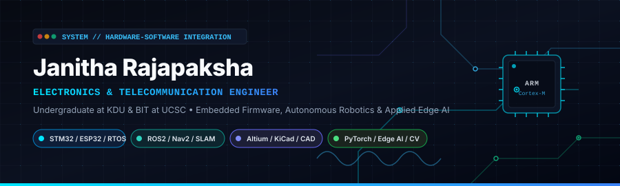

  

    

  
  
  
  

 

### ⚡ Engineering Overview

I am an **Electronics Engineering undergraduate** at General Sir John Kotelawala Defence University (KDU) and a **Bachelor of Information Technology (BIT)** student at the University of Colombo School of Computing (UCSC). 

My engineering focus centers on **hardware-software co-design**: engineering real-time embedded firmware, designing custom PCBs, deploying computer vision and deep learning models to the edge, and architecting autonomous robotic systems.

* 🔬 **Research Focus:** Edge AI, Unsupervised Domain Adaptation in computer vision, and distributed acoustic IoT sensor networks (*Awarded research stay at ComNets, University of Bremen, Germany*).
* 💼 **Industry Background:** Former Electronic Engineering Intern at **Idea8 (Pvt) Ltd** (ROS2, Nav2, MoveIt2, SLAM, embedded RTOS, custom PCB layout) and Co-Founder at **VisionCraft** (rapid prototyping, 3D CAD, and PCB fabrication).
* 🛠️ **Core Philosophy:** Direct, reliable physical implementations where embedded firmware, analog circuitry, mechanical precision, and algorithmic intelligence converge.

---

### 🏛️ Engineering Domains

<table>
  <tr>
    <td width="50%" valign="top">
      <h4>⚡ Embedded Systems &amp; Firmware</h4>
      <ul>
        <li><b>Microcontrollers:</b> STM32 (ARM Cortex-M), ESP32, Raspberry Pi</li>
        <li><b>Firmware Architecture:</b> FreeRTOS, Bare-Metal C/C++, HAL</li>
        <li><b>Low-Level Control:</b> Hardware-timer quadrature encoders, DMA, 1 kHz PI/PID wheel-speed control loops</li>
        <li><b>Peripherals &amp; Protocols:</b> I2C, SPI, UART, CAN, ADC/DAC, Timers</li>
      </ul>
    </td>
    <td width="50%" valign="top">
      <h4>🤖 Robotics &amp; Autonomous Navigation</h4>
      <ul>
        <li><b>Frameworks:</b> ROS &amp; ROS2 (Humble/Iron), Nav2, MoveIt2</li>
        <li><b>Algorithms:</b> Zero-heap Micromouse FloodFill, SLAM, A*, Dijkstra</li>
        <li><b>Kinematics:</b> Differential drive, Omnidirectional/Mecanum platforms</li>
        <li><b>Sensory &amp; Localization:</b> UWB positioning, 2D LiDAR, ToF (VL6180X), Ultrasonic</li>
      </ul>
    </td>
  </tr>
  <tr>
    <td width="50%" valign="top">
      <h4>📐 Electronics &amp; Hardware Design</h4>
      <ul>
        <li><b>EDA &amp; Schematics:</b> Altium Designer, KiCad, EasyEDA</li>
        <li><b>Analog Circuitry:</b> Op-amps, active bandpass filters, instrumentation</li>
        <li><b>Power &amp; Drive:</b> MOSFET bridges (BTS7960), buck/boost regulators, power distribution</li>
        <li><b>Bench Instrumentation:</b> Digital Storage Oscilloscopes, Function Generators, Logic Analyzers</li>
      </ul>
    </td>
    <td width="50%" valign="top">
      <h4>🧠 Machine Learning &amp; Computer Vision</h4>
      <ul>
        <li><b>Deep Learning:</b> PyTorch, TensorFlow, Scikit-learn</li>
        <li><b>Computer Vision:</b> OpenCV, MediaPipe, YOLOv5, TensorFlow Object Detection</li>
        <li><b>Research:</b> Deep CORAL (Unsupervised Domain Adaptation for textile inspection)</li>
        <li><b>Edge &amp; LLMs:</b> 4-bit GGUF quantization, Ollama deployment, RAG agent pipelines</li>
      </ul>
    </td>
  </tr>
</table>

---

### 🚀 Featured Engineering Projects

#### 1. [Embedded FloodFill Navigation Engine & STM32 Controller](https://github.com/JanithaRajapaksha/FloodFill-Micromouse)
* **Repositories:** [`FloodFill-Micromouse`](https://github.com/JanithaRajapaksha/FloodFill-Micromouse) &bull; [`bluepill_motor_test`](https://github.com/JanithaRajapaksha/bluepill_motor_test)
* **Stack:** `C` &bull; `STM32CubeIDE` &bull; `ARM Cortex-M3 (STM32F103)` &bull; `ESP32` &bull; `PyQt6` &bull; `Pygame`
* **Architecture:**
  * Ultra-compact (<600 B RAM), zero-heap dynamic memory maze-solving engine designed for embedded microcontrollers.
  * Native STM32 firmware running hardware timer-based quadrature encoder decoding with dual independent 1 kHz PI speed controllers.
  * Real-time odometry verification GUI built in PyQt6 with fog-of-war exploration tracking and official MMS (Mackorone Micromouse Simulator) integration.

#### 2. [Smart Retail Management System with IoT and ML](https://github.com/JanithaRajapaksha/smart-retail-management-system-with-iot-and-ml)
* **Accolades:** 🏆 **1st Place (Best Project – ET Category)**, EXPO'25 Individual Design Project &bull; **Semi-Finalist**, FINNC'25 (IEEE UoM)
* **Stack:** `Python` &bull; `Raspberry Pi` &bull; `24GHz mmWave Radar (LD2410B)` &bull; `HX711 Load Cells` &bull; `MediaPipe` &bull; `Node-RED` &bull; `MQTT`
* **Architecture:**
  * Multi-sensor edge perception node monitoring retail product interaction in real time.
  * Fuses human micro-presence detection via 24GHz FMCW radar with high-precision shelf weight monitoring.
  * On-device head-pose estimation and gaze-direction tracking via MediaPipe to measure shopper engagement without invasive tracking.

#### 3. [Fabric Defect Detection with Unsupervised Domain Adaptation](https://github.com/JanithaRajapaksha/Fabric-Defect-Detection-Using-Domain-adaption)
* **Publication:** Research manuscript under peer review (*Enhancing Fabric Defect Detection in Heterogeneous Manufacturing Environments*)
* **Stack:** `Python` &bull; `PyTorch` &bull; `Deep CORAL` &bull; `ResNet` &bull; `Computer Vision`
* **Architecture:**
  * Implemented Deep Correlation Alignment (Deep CORAL) in PyTorch to align nonlinear feature distributions across heterogeneous manufacturing domains.
  * Successfully bridged the domain gap between grayscale textile reference benchmarks and industrial color imagery without requiring labeled target samples.

#### 4. [VisionCraft OS – Manufacturing & Slicing Automation Platform](https://github.com/JanithaRajapaksha/vision-craft-web)
* **Role:** Co-Founder &amp; Lead Systems Developer
* **Stack:** `TypeScript` &bull; `Next.js` &bull; `WebGL / Three.js` &bull; `PrusaSlicer CLI` &bull; `OrcaSlicer CLI` &bull; `TailwindCSS`
* **Architecture:**
  * Centralized operating platform for VisionCraft engineering operations (3D printing, custom PCB fabrication, and electronics prototyping).
  * WebGL-powered 3D CAD model ingestion (`.stl`, `.3mf`, `.obj`) paired with asynchronous headless slicing engines for automated volumetric toolpath and filament calculation.
  * Dynamic quoting engine accounting for machine depreciation, electrical tariffs, and labor margins.

#### 5. [Distributed IoT Acoustic Sensor Network (FYP)](https://github.com/JanithaRajapaksha)
* **Honour:** 🌐 **Selected for 2-Month International Research Stay** at **Communication Networks (ComNets), University of Bremen, Germany**
* **Stack:** `Embedded C` &bull; `Analog Signal Conditioning` &bull; `Piezoelectric Transducers` &bull; `MFCC Feature Extraction` &bull; `Edge ML`
* **Architecture:**
  * Acoustic sensor network for non-destructive early detection of Red Palm Weevil larvae inside palm trunks.
  * Designed custom analog pre-amplification and active bandpass filter stages to condition faint bio-acoustic acoustic emissions.
  * Extracts Mel-Frequency Cepstral Coefficients (MFCC) for edge classification, transmitting alerts across an energy-efficient wireless mesh.

#### 6. [Multifunctional Autonomous Mobile Robot](https://github.com/JanithaRajapaksha/embedded-systems-robot)
* **Stack:** `C++` &bull; `ESP32` &bull; `GA25 DC Motors` &bull; `VL6180X Time-of-Flight` &bull; `IR Reflectance Array` &bull; `Ultrasonic`
* **Architecture:**
  * Autonomous mobile robot equipped with optical encoder feedback, multi-channel analog sensor array, and servo-actuated manipulator.
  * Implemented PID-based high-speed line tracking, intersection decision trees, dynamic maze exploration, and box detection via Time-of-Flight ranging.

---

### 💻 Technical Skills Matrix

| Category | Technologies &amp; Tools |
| :--- | :--- |
| **Languages** | `C` &bull; `C++` &bull; `Python` &bull; `TypeScript` &bull; `JavaScript` &bull; `SQL` &bull; `Bash` &bull; `LaTeX` |
| **Microcontrollers &amp; Embedded** | `STM32 (ARM Cortex-M)` &bull; `ESP32` &bull; `Raspberry Pi` &bull; `FreeRTOS` &bull; `STM32CubeIDE` &bull; `PlatformIO` &bull; `DMA / HAL` |
| **Robotics &amp; Control** | `ROS / ROS2 (Humble)` &bull; `Nav2` &bull; `MoveIt2` &bull; `SLAM` &bull; `PID Tuning` &bull; `Odometry` &bull; `UWB Localization` &bull; `Gazebo` |
| **Electronics &amp; PCB Design** | `Altium Designer` &bull; `KiCad` &bull; `EasyEDA` &bull; `LTSpice` &bull; `Analog Filters &amp; Op-Amps` &bull; `Power Distribution` |
| **CAD &amp; Digital Fabrication** | `SolidWorks` &bull; `Autodesk Fusion 360` &bull; `3D Printing (FDM)` &bull; `PrusaSlicer / OrcaSlicer` &bull; `Rapid Prototyping` |
| **AI, Machine Learning &amp; CV** | `PyTorch` &bull; `TensorFlow` &bull; `OpenCV` &bull; `MediaPipe` &bull; `Scikit-learn` &bull; `Deep CORAL` &bull; `YOLO` &bull; `Ollama / RAG` |
| **Development &amp; Cloud Tools** | `Git &amp; GitHub` &bull; `Linux (Ubuntu)` &bull; `Docker` &bull; `MQTT` &bull; `Node-RED` &bull; `Next.js` &bull; `React` &bull; `FastAPI` &bull; `Firebase` |

---

### 🏆 Honours &amp; Recognitions

* 🇩🇪 **International Research Stay – University of Bremen, Germany (2025/2026)**  
  *Winner of University IoT Competition* – Selected to conduct a 2-month research project on distributed sensor networks at the Communication Networks (ComNets) group.
* 🥇 **1st Place (Best Project – ET Category) – EXPO'25 Individual Design Project Exhibition**  
  General Sir John Kotelawala Defence University, for the *Smart Retail Management System Integrating IoT and ML*.
* 🥇 **1st Place – IGNITE'25 Engineering Undergraduates Exhibition**  
  Faculty of Engineering, KDU, for the *Slope Rollback Prevention System for Manual Vehicles*.
* 🎖️ **Semi-Finalist – FINNC'25**  
  Organized by the IEEE Student Branch, University of Moratuwa.

---

### 📊 GitHub Activity &amp; Engineering Metrics

  
  
    
  

 

---

  Engineered by <b>Janitha Rajapaksha</b> • Electronics &amp; Telecommunication Engineering Undergrad 
  Let's connect: <a href="https://www.linkedin.com/in/janitha-rajapaksha-7b3544179">LinkedIn</a> • <a href="mailto:jlkrajapaksha@gmail.com">jlkrajapaksha@gmail.com</a>

